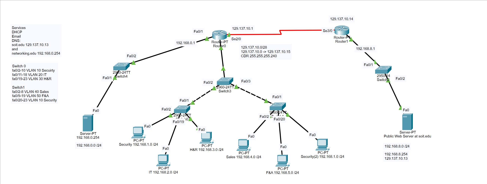
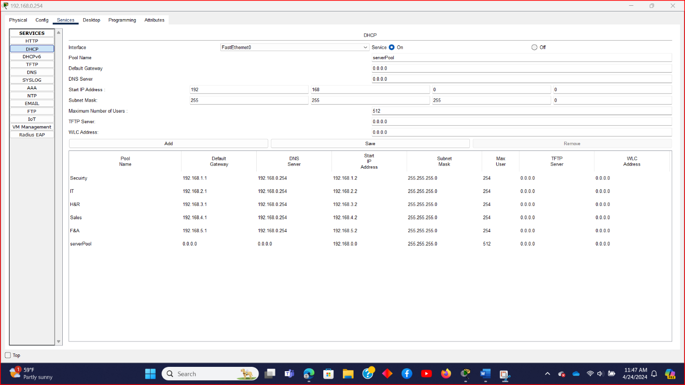
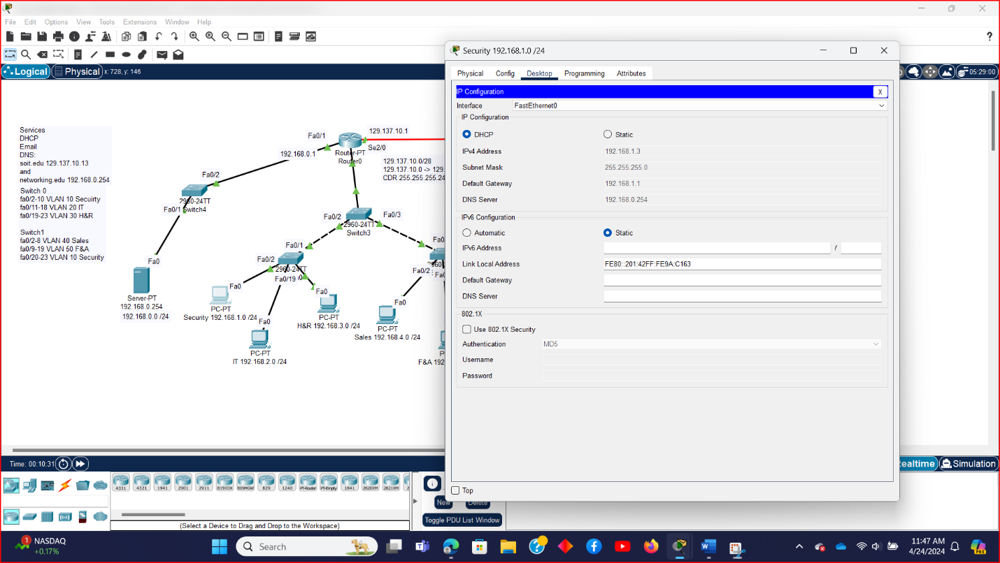
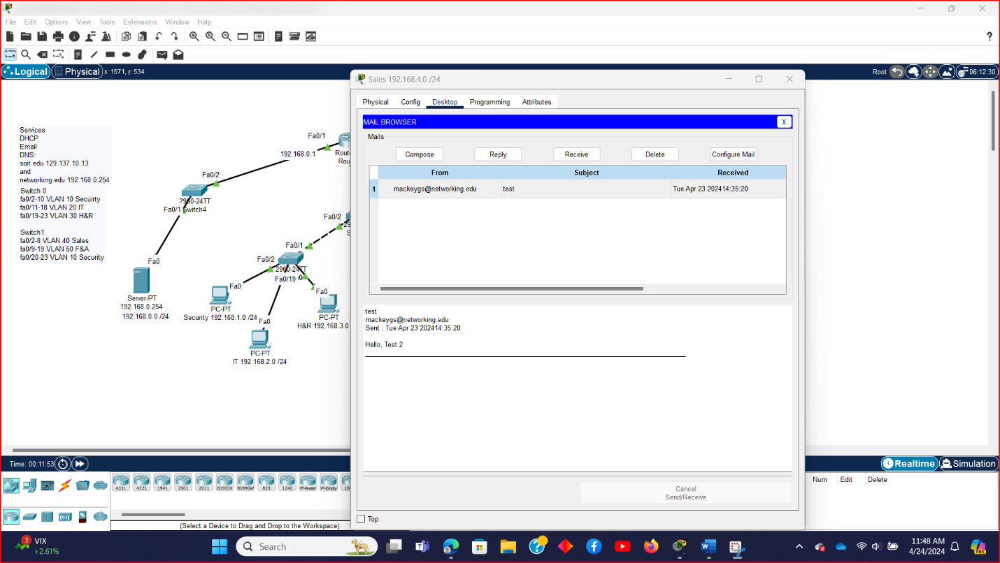
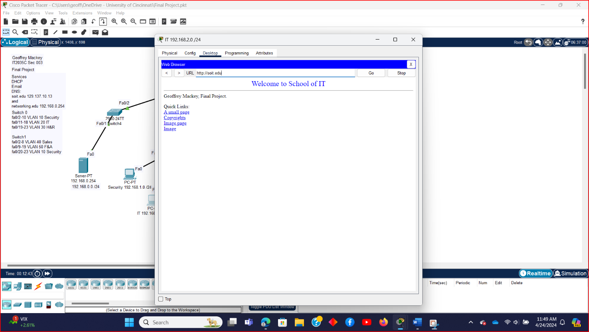

# Campus Network Build: VLANs, Inter-VLAN Routing, EIGRP, NAT, and Network Services in Cisco Packet Tracer


A networking project in which I designed, cabled, and configured a two-site network in Cisco Packet Tracer. A private campus network segments five departments into their own VLANs behind a router-on-a-stick, with a services LAN that hands out addresses, resolves names, and runs email. A separate public network hosts a web server. The two sites are joined by a serial WAN link running EIGRP, with dynamic NAT translating the private side out to the public addressing and static NAT publishing the web server. Everything was verified end to end: clients pick up their addressing over DHCP, send and receive email, and load the public site by name at `http://soit.edu`.

The scenario is a fictional university **School of IT**, with an internal domain of `networking.edu` and a public site at `soit.edu`.

---

## Table of Contents

- [Highlights](#highlights)
- [Topology](#topology)
- [Repository Structure](#repository-structure)
- [Addressing Plan](#addressing-plan)
- [How It Was Built](#how-it-was-built)
  - [VLANs and Trunking](#vlans-and-trunking)
  - [Inter-VLAN Routing with Router-on-a-Stick](#inter-vlan-routing-with-router-on-a-stick)
  - [Centralized DHCP with Helper Addresses](#centralized-dhcp-with-helper-addresses)
  - [EIGRP Between Sites](#eigrp-between-sites)
  - [Dynamic and Static NAT](#dynamic-and-static-nat)
  - [DNS, Email, and the Public Web Server](#dns-email-and-the-public-web-server)
- [Verification](#verification)
- [What I Learned](#what-i-learned)
- [What I Would Improve](#what-i-would-improve)

---

## Highlights

Five departments, Security, IT, H&R, Sales, and F&A, each live in their own VLAN and `/24` subnet, spread across two access switches and tied together by a distribution switch with 802.1Q trunks. A single router interface with five subinterfaces routes between all of them. One server provides DHCP for every VLAN through `ip helper-address`, so no department needs its own DHCP server. EIGRP shares routes across the serial WAN link. Outbound traffic from all private subnets is translated through a pool of public addresses with PAT, while the web server is published at a fixed public address with static NAT. DNS resolves both the internal `networking.edu` and public `soit.edu` names.

---

## Topology



| Device | Model | Role |
|--------|-------|------|
| Router0 | Router-PT | Private-side router: inter-VLAN routing, DHCP relay, EIGRP, dynamic NAT |
| Router1 | Router-PT | Public-side router: EIGRP, static NAT for the web server |
| Switch3 | 2960-24TT | Distribution switch; trunks to Router0 and both access switches |
| Switch0 | 2960-24TT | Access switch for Security, IT, and H&R |
| Switch1 | 2960-24TT | Access switch for Sales, F&A, and a second Security port |
| Switch4 | 2960-24TT | Services LAN switch for the local server |
| Switch2 | 2950-24 | Public network switch for the web server |
| Local Server | Server-PT | DHCP, DNS, and email at 192.168.0.254 |
| Public Web Server | Server-PT | HTTP site for `soit.edu` at 192.168.8.254 |

---

## Repository Structure

```
campus-network/
├── configs/                      # Running configs exported from every router and switch
│   ├── router0-internal.cfg
│   ├── router1-web.cfg
│   ├── switch0-access-a.cfg
│   ├── switch1-access-b.cfg
│   ├── switch2-web.cfg
│   ├── switch3-distribution.cfg
│   └── switch4-server.cfg
├── docs/
│   └── images/
└── README.md
```

---

## Addressing Plan

| Network | VLAN | Subnet | Gateway | Addressing |
|---------|:---:|--------|---------|------------|
| Security | 10 | 192.168.1.0/24 | 192.168.1.1 | DHCP |
| IT | 20 | 192.168.2.0/24 | 192.168.2.1 | DHCP |
| H&R | 30 | 192.168.3.0/24 | 192.168.3.1 | DHCP |
| Sales | 40 | 192.168.4.0/24 | 192.168.4.1 | DHCP |
| F&A | 50 | 192.168.5.0/24 | 192.168.5.1 | DHCP |
| Services LAN | – | 192.168.0.0/24 | 192.168.0.1 | Static (server at .254) |
| Public web network | – | 192.168.8.0/24 | 192.168.8.1 | Static (server at .254) |
| Serial WAN | – | 129.137.10.0/28 | – | Router0 .1, Router1 .14 |
| Dynamic NAT pool | – | 129.137.10.2 – .12 | – | PAT for private hosts |
| Static NAT | – | 129.137.10.13 | – | Public web server |

---

## How It Was Built

### VLANs and Trunking

Each access switch carries only the VLANs it needs. On Switch0, ports `Fa0/2–10` are Security (VLAN 10), `Fa0/11–18` are IT (VLAN 20), and `Fa0/19–23` are H&R (VLAN 30). On Switch1, `Fa0/2–8` are Sales (VLAN 40), `Fa0/9–19` are F&A (VLAN 50), and `Fa0/20–23` are a second Security segment (VLAN 10), showing that one VLAN can span multiple switches. The distribution switch, Switch3, knows all five VLANs and trunks them to the router, while each downlink trunk is restricted to only the VLANs that access switch actually uses.

```
! Switch0 (access)
vlan 10
 name Security
vlan 20
 name IT
vlan 30
 name H&R
interface range fa0/2-10
 switchport mode access
 switchport access vlan 10
interface fa0/1
 switchport mode trunk
 switchport trunk allowed vlan 10,20,30

! Switch3 (distribution)
interface fa0/1
 switchport mode trunk            ! uplink to Router0
interface fa0/2
 switchport mode trunk
 switchport trunk allowed vlan 10,20,30
interface fa0/3
 switchport mode trunk
 switchport trunk allowed vlan 10,40,50
```

### Inter-VLAN Routing with Router-on-a-Stick

Rather than giving every VLAN its own physical router port, Router0 uses a single trunked interface split into five 802.1Q subinterfaces. Each subinterface tags traffic for one VLAN and acts as that department's default gateway.

```
interface FastEthernet0/0.1
 encapsulation dot1Q 10
 ip address 192.168.1.1 255.255.255.0
 ip helper-address 192.168.0.254
interface FastEthernet0/0.2
 encapsulation dot1Q 20
 ip address 192.168.2.1 255.255.255.0
 ip helper-address 192.168.0.254
! ...and likewise for VLANs 30, 40, and 50
```

### Centralized DHCP with Helper Addresses

DHCP requests are broadcasts and do not cross router boundaries on their own. The `ip helper-address 192.168.0.254` on each subinterface relays those requests to the local server, which holds a separate pool per department. Each pool hands out the right gateway for its VLAN, with `192.168.0.254` as the DNS server.

| Pool | Default Gateway | DNS Server | Start Address |
|------|-----------------|------------|---------------|
| Security | 192.168.1.1 | 192.168.0.254 | 192.168.1.2 |
| IT | 192.168.2.1 | 192.168.0.254 | 192.168.2.2 |
| H&R | 192.168.3.1 | 192.168.0.254 | 192.168.3.2 |
| Sales | 192.168.4.1 | 192.168.0.254 | 192.168.4.2 |
| F&A | 192.168.5.1 | 192.168.0.254 | 192.168.5.2 |



### EIGRP Between Sites

Both routers run EIGRP autonomous system 1 and advertise their connected networks across the serial link, so each site learns how to reach the other without static routes. Router0 covers the private subnets with two wildcard statements, `192.168.0.0 0.0.3.255` for `.0` through `.3` and `192.168.4.0 0.0.1.255` for `.4` and `.5`.

```
! Router0
router eigrp 1
 network 129.137.10.0 0.0.0.15
 network 192.168.0.0 0.0.3.255
 network 192.168.4.0 0.0.1.255

! Router1
router eigrp 1
 network 129.137.10.0 0.0.0.15
 network 192.168.8.0
```

### Dynamic and Static NAT

On the private side, Router0 translates any source address in `192.168.0.0/21` to a pool of public addresses, `129.137.10.2` through `.12`, with `overload` enabling port address translation so many hosts can share the pool. A single `/21` access list covers all six private subnets in one line.

On the public side, Router1 maps the web server's private address `192.168.8.254` to the fixed public address `129.137.10.13`, so it is always reachable at the same address from outside.

```
! Router0 – dynamic NAT with PAT
access-list 1 permit 192.168.0.0 0.0.7.255
ip nat pool MYPOOL 129.137.10.2 129.137.10.12 netmask 255.255.255.240
ip nat inside source list 1 pool MYPOOL overload

! Router1 – static NAT for the web server
ip nat inside source static 192.168.8.254 129.137.10.13
```

### DNS, Email, and the Public Web Server

The local server runs DNS with two A records: `networking.edu` pointing to the server itself at `192.168.0.254`, and `soit.edu` pointing to the web server's public NAT address, `129.137.10.13`. It also runs SMTP and POP3 for the `networking.edu` mail domain, with a personal mailbox and a test account. The public web server hosts a customized School of IT landing page.

---

## Verification

**Dynamic addressing.** A client in the Security VLAN received `192.168.1.3/24` with gateway `192.168.1.1` and DNS server `192.168.0.254`, confirming that the helper address relayed its request across the router to the correct pool.



**Email.** A message sent from my `networking.edu` account was delivered and read in a client's mail browser, proving SMTP, POP3, and DNS for the mail domain all worked.



**Public web access by name.** A client in the IT VLAN loaded `http://soit.edu`. That single request exercised nearly the whole design: DNS resolution, inter-VLAN routing, dynamic NAT on the way out, EIGRP across the WAN, and static NAT on the way in to the web server.



---

## What I Learned

This project tied together the pieces of a working network in a way that individual labs do not. VLANs only become useful once something routes between them, DHCP only reaches other subnets with a relay, and a public service only becomes reachable once routing and both directions of NAT line up. Loading a web page by name from a segmented client turned out to be a great end-to-end test, because it fails if any single layer is wrong. It also gave me a feel for designing with summarization in mind, such as covering six subnets with one `/21` access list and two EIGRP statements.

---

## What I Would Improve

Looking back at the configuration exported from the project file, there are a few things I would change in a real deployment.

| Area | Improvement |
|------|-------------|
| Device identity | Give every router and switch a meaningful hostname instead of the default `Router` and `Switch` |
| Management security | Set an enable secret, configure SSH instead of Telnet on the VTY lines, add login banners, and turn on `service password-encryption` |
| Switch hardening | Shut unused ports, move them to an unused VLAN, and enable port security on access ports |
| Native VLAN | Move trunks off the default native VLAN 1 |
| Cleanup | Remove a leftover address and NAT statement on Router0's unused `Serial3/0`, and the unused default DHCP pool on the server |
| Routing | Add `no auto-summary` to EIGRP so subnets are advertised exactly as configured |
| Redundancy | Add a second distribution switch and router so a single failure does not take down every VLAN |

---

## Author

**Geoffrey Mackey**, Cybersecurity and Information Technology student at the University of Cincinnati.
